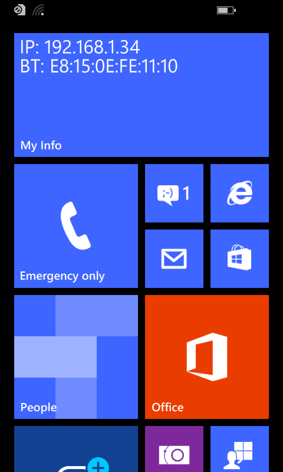
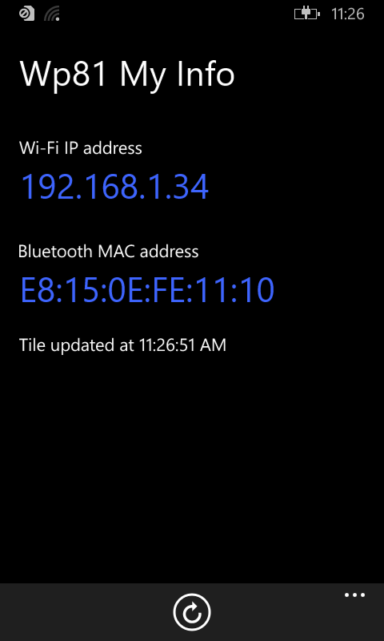

# wp81MyInfo
Display the Wi-Fi IP address and the Bluetooth MAC address of a Windows Phone 8.1 in the tile of the application.

Pin the application to the Start screen and use the medium or wide tile size. Each address has its own line and prefix:

```
IP: 192.168.1.36
BT: 78:92:3E:C7:7B:53
```

The lines of the medium tile don't wrap, so it shows the Bluetooth address without colons (`BT: 78923EC77B53`).
The tile shows `IP: No Wi-Fi` without a Wi-Fi network and `BT: Unknown` if the Bluetooth address can't be read.

The tile is updated:
- when the application is launched or resumed, or when "Refresh" is pressed,
- by a background task, each time the network changes and every 30 minutes.

Launch the application once after installation to register the background task.

  


## Bluetooth address
The application reads the address the same way as the driver QcBluetooth8930.sys:
1. The file `C:\DPP\QCOM\BT.PROVISION` (first byte 1, address in bytes 2 to 7, most significant byte first).
2. The value `BDAddr` of `HKLM\SYSTEM\CurrentControlSet\Services\qcbluetooth\Parameters` (6 bytes, least significant byte first).

When both fail, the application displays the reason under "Bluetooth MAC address", for example `BT.PROVISION: error 5, BDAddr: error 2` (Win32 error codes).

## Projects
- `Wp81MyInfo`: the application (C++/CX, XAML).
- `Wp81MyInfoTasks`: Windows Runtime Component with the tile update code and the background task (`Wp81MyInfoTasks.UpdateTileTask`).

Project requires Visual Studio 2015 with Windows Phone 8.1 support.
